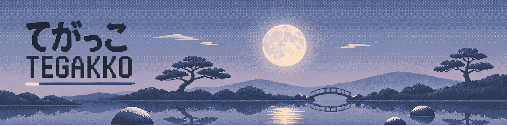

<h1 align="center">
  
</h1>

*Tegakko* is a quiet Japanese handwriting-recall practice app. It prompts you with a kana, you write it from memory with a pen, then judge your own attempt. Characters you miss come round more often.

## Idea

- **Recall, then write.** Prompts give kana in romaji and identify the script; there is no tracing guide or answer shown under your ink.
- **You decide if it was right.** Reveal lets you compare your writing with the reference, but never grades it for you.
- **Weak spots shape the next session.** Recent misses pull cards into the sample more often; there are no due dates or spaced-repetition schedule.
- **A notebook, not a habit tracker.** Sessions end in a plain summary, with history to see how practice is going.
- **Your data stays on your device.** There are no accounts or sync. Export and import are available in Settings.

The interface and interaction choices are in [docs/design.md](docs/design.md); terminology is in [GLOSSARY.md](GLOSSARY.md), and decisions are in [docs/adr](docs/adr).

## Status

The app is a local-first PWA for handwriting practice, with scope selection, drill, summary, history and settings screens. It is designed for a portrait Chromium-based Android tablet with a stylus and works offline after installation. The app is built for Cloudflare Workers; the configured deployment uses a `*.workers.dev` origin.

## Stack

TypeScript, Svelte 5 and Vite, with IndexedDB via [idb](https://github.com/jakearchibald/idb). The PWA is hosted on Cloudflare Workers.

## Running it

Tools are managed with [mise](https://mise.jdx.dev).

```sh
mise install
mise run install
mise run dev           # serves the app locally
```

Other tasks: `mise run check` runs lint, typecheck and tests; `mise run build` builds the PWA into `dist/`.
