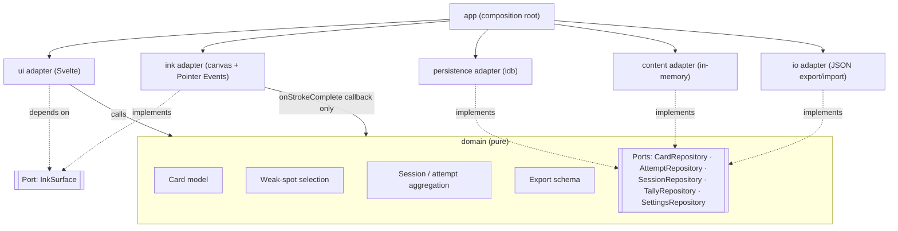
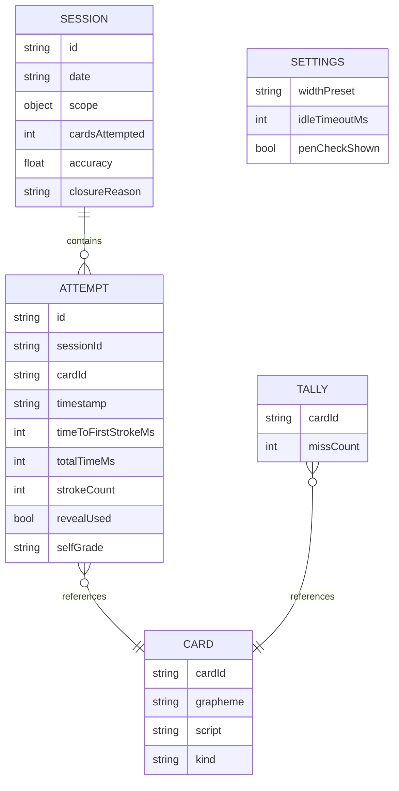

# Architecture Spine — jplearn-kana-v1

## Design Paradigm

**Ports & Adapters (Hexagonal)**, with one adapter — ink — deliberately isolated from the framework's reactive update cycle for latency.

- **Domain** (`src/domain/`) — pure TypeScript: card model, weak-spot selection algorithm, session/attempt aggregation, export/import schema validation. No DOM, IndexedDB, or Svelte import ever appears here.
- **Ports** (`src/ports/`) — interfaces the domain (and, for `InkSurface`, the `ui` adapter) depend on: `CardRepository`, `AttemptRepository`, `SessionRepository`, `TallyRepository`, `SettingsRepository`, `InkSurface`. Signatures fixed in AD-9.
- **Adapters** (`src/adapters/`) — implement or call the domain from outside: `persistence` (IndexedDB), `content` (in-memory card catalog), `ink` (canvas + Pointer Events + Delegated Ink Trails), `ui` (Svelte), `io` (JSON export/import). Adapters depend inward on domain+ports; they never import a sibling adapter's implementation module directly — a cross-adapter interaction (only `ui`→`ink` exists) goes through a port.
- **App** (`src/app/`) — composition root: wires adapters to ports, boots the PWA/service worker.



## Invariants & Rules

### AD-1 — Dependency direction is domain-inward; cross-adapter interaction goes through a port

- **Binds:** all
- **Prevents:** a persistence detail (IndexedDB shape) or a UI detail (Svelte reactivity) leaking into business logic; the ink adapter importing Svelte or vice versa; an unreviewed new sibling-adapter import quietly coupling two adapters.
- **Rule:** `domain/` imports nothing from `adapters/` or `app/`. `ports/` types reference only `domain/` types. Every adapter imports `domain/` and/or `ports/`, never a sibling adapter's implementation module — the one necessary cross-adapter interaction (`ui` needs `ink`'s canvas) goes through the `InkSurface` port (AD-2, AD-9), not a direct import. `app/` is the only module allowed to import concrete adapter implementations across the board, for wiring. Enforced by an import-boundary ESLint rule (e.g. `eslint-plugin-boundaries`) configured to reject any `adapters/x` → `adapters/y` import outside `app/`.

### AD-2 — The ink adapter owns its canvas node outside Svelte's reactive tree

- **Binds:** FR-3
- **Prevents:** a future refactor moving stroke rendering into Svelte state/props, reintroducing the exact re-render-on-the-hot-path risk the web-vs-native PoC decision was made to avoid; a two-layer (grid + ink) canvas reintroducing the compositing bug the web PoC hit under Delegated Ink Trails; an ambiguous `onStrokeComplete` payload letting two implementations disagree on what data a completed stroke carries.
- **Rule:** the `ink` adapter implements the `InkSurface` port:
  - `mount(node: HTMLElement): void` — attaches `pointerdown`/`pointermove`/`pointerup` listeners and Delegated Ink Trails directly to `node`. The Svelte `ui` adapter calls this once (`onMount`) and never re-renders inside `node`.
  - `clear(): void` — wipes the canvas for the next prompt.
  - `onStrokeComplete(cb: (stroke: { points: {x: number; y: number; pressure: number}[]; widthPreset: WidthPreset; startedAt: number; endedAt: number }) => void): void` — fires once per completed stroke, never per pointer event. `startedAt`/`endedAt` are stroke-local timestamps; the domain combines these with the `ui`-owned `promptShownAt` timestamp to compute FR-8's `timeToFirstStrokeMs`/`totalTimeMs` — the ink adapter itself has no notion of "prompt" or "attempt."
  - The genkouyoushi grid and the ink strokes render on **one** canvas element, not two layered canvases (the addendum's PoC documented a black-canvas compositing bug from a two-canvas setup under Delegated Ink Trails).
- **Exemption:** the first-run pen-check screen's live pressure readout (EXPERIENCE.md) is a diagnostic surface, not the drill's ink-rendering hot path — it may attach its own separate, lightweight `pointermove` listener directly rather than going through `onStrokeComplete`'s once-per-stroke contract.

### AD-3 — Card content is static, in-memory data, not an IndexedDB store

- **Binds:** FR-1, FR-5
- **Prevents:** a builder adding IndexedDB seed/migration logic for content that never changes at runtime in v1.
- **Rule:** the 158-card catalog (46 base hiragana + 46 base katakana + 66 yoon — the PRD's own `[NOTE FOR PM]` explains this as a deliberate extension of the brief's 92-base-character scope to include yoon, not an unreconciled delta) is a TypeScript module (`domain/cards.ts`) compiled into the bundle. `CardRepository` is implemented by `adapters/content`, an in-memory adapter reading that module — not by `persistence`. `cardId` is the natural key `"<grapheme>:<script>"`, referenced by `tallies` and `attempts` as a plain string foreign key — no join table. Reveal (FR-5) reads the same static catalog directly.

### AD-4 — Persisted schema: grid-relative strokes embedded in Attempt, structured Scope, canonical closure enum

- **Binds:** FR-8, FR-9, FR-12
- **Prevents:** a builder "correctly" normalizing strokes into their own IndexedDB store/join; storing stroke points as absolute viewport pixels (breaks replay across devices/viewports); serializing `Session.scope` as a display string that round-trips lossily; two independently-built pieces of closure logic inventing different closure-reason strings (the PRD itself uses `endReason` in places and `closureReason` in others for the same concept).
- **Rule:**
  - Each persisted `Attempt` embeds its `strokes: Stroke[]` directly — `Stroke = { points: {x: number; y: number; pressure: number}[]; widthPreset: WidthPreset }`, **points stored relative to the grid cell, never absolute viewport pixels**. "Links to its raw stroke data" (FR-8) is satisfied by direct containment, not a join. (`tiltX`/`tiltY`, part of the Pointer Events surface explored in the PoC, are intentionally not persisted — FR-12 specifies only x/y/pressure.)
  - `Session.scope` is a structured object, `{ scripts: ('hiragana' | 'katakana')[]; units: ('base' | 'yoon')[] }` — not a bare string. IndexedDB's structured-clone algorithm stores this natively.
  - `closureReason` is the one canonical field name and type everywhere in code: `'explicit' | 'full-scope' | 'inactivity'`.
  - `selfGrade` is the literal union `'correct' | 'incorrect'` everywhere, including in `AttemptExport` (AD-5).

### AD-5 — Export/import: the exported Attempt shape strips ink data; import always replaces

- **Binds:** FR-13
- **Prevents:** a naive export implementation serializing the persisted `Attempt` record as-is and leaking raw ink data into the backup file, which FR-13 explicitly puts out of scope; an import implementation that merges instead of replaces, silently diverging from the PRD's stated destructive-by-default behavior.
- **Rule:** the `io` adapter maps `Attempt → AttemptExport` (all fields except `strokes`) before serializing. Import validates the file against the `AttemptExport` (not `Attempt`) schema + a `version` field, rejecting anything that doesn't match before applying anything. On a valid import, all current `tallies`/`attempts`/`sessions` are deleted and replaced wholesale with the imported data — never merged record-by-record.

### AD-6 — TypeScript strict mode, enforced, no exceptions

- **Binds:** all
- **Prevents:** an untyped or loosely-typed adapter silently breaking the domain/port contract without a compiler catching it; `strict: true` alone doesn't forbid an explicit `any`, so that gap is closed separately.
- **Rule:** `strict: true` in `tsconfig.json`, applied to `domain/`, `ports/`, `adapters/`, and `app/` alike. `@typescript-eslint/no-explicit-any` enabled as an error (not a warning) — no `any` anywhere, least of all at a port boundary.

### AD-7 — Service worker updates apply silently, no update-prompt UI

- **Binds:** FR-14
- **Prevents:** building an update-available banner/toast component and the state to drive it, for a single-user app where staleness has no multi-tenant cost.
- **Rule:** `vite-plugin-pwa` is configured with `registerType: 'autoUpdate'`. A new build takes over on the next load with no user-facing prompt.

### AD-8 — Production build is hosted on a stable public HTTPS origin, independent of the dev machine

- **Binds:** FR-14
- **Prevents:** the installed PWA's install/update path silently depending on a laptop being powered on and reachable over LAN, which the PoC setup did.
- **Rule:** the built static output deploys to **Cloudflare Pages**, connected to the project's GitHub repo via Cloudflare's native Git integration — every push to `main` triggers an automatic build+deploy, other branches get preview deployments, with no GitHub Actions workflow file required for this path. No custom domain in v1 — the default `*.pages.dev` origin satisfies the HTTPS/secure-context requirement Delegated Ink Trails and PWA installability both need, on the Chromium-based Android tablet + stylus target this whole spine is scoped to (no Safari/iPad, no phone form factor). A `Justfile` recipe (`just deploy`) wraps an on-demand `wrangler pages deploy dist` for manual/local deploys outside the Git-triggered flow. *(Amended 2026-09-03: originally specified GitHub Pages + GitHub Actions; changed on user request, no other AD depends on the prior hosting choice.)*

### AD-9 — Repository port method signatures are fixed, not left to implementers

- **Binds:** FR-1, FR-2, FR-6, FR-7, FR-8, FR-10, FR-11, FR-13
- **Prevents:** two independently-built pieces of code (e.g. the `tallies` writer in the drill loop and AD-13's undo) satisfying "a `TallyRepository`" with incompatible designs — one assuming atomic increment/decrement, another assuming read-modify-write, or one omitting a decrement primitive entirely and hand-rolling `get`+`save` for undo; two independent implementations of `listAll()` disagreeing on exhaustiveness — one returning the full attempt history, another silently paginating or truncating it, which would make old-but-unresolved weak spots invisible to AD-10's selection without any port-level signal that truncation happened.
- **Rule:**
  - `CardRepository`: `getAll(): Card[]`, `getById(cardId: string): Card`.
  - `TallyRepository`: `getAll(): Tally[]`, `increment(cardId: string): void`, `decrement(cardId: string): void` — both atomic, never a `get` + `save` pair (avoids a read-modify-write race across attempts). `decrement` is used only by AD-13's undo; an implementation clamps at zero rather than going negative. `Tally` backs only the lifetime cumulative miss-count displays (AD-10) — it stays a normal mutable store regardless of that display-only *selection* role.
  - `AttemptRepository`: `add(attempt: Attempt): void`, `listBySession(sessionId: string): Attempt[]`, `listAll(): Attempt[]` — returns the complete, unpaginated attempt history; an adapter must never truncate or page this by default, since AD-10's weak-spot selection depends on seeing old-but-unresolved misses, not just recent ones (AD-10's selection reads this once per session start, not `listBySession` in a loop). `deleteLast(sessionId: string): void` (used by AD-13's undo).
  - `SessionRepository`: `add(session: Session): void`, `list(): Session[]`.
  - `SettingsRepository`: `get(): Settings`, `save(settings: Settings): void`.

### AD-10 — Weak-spot selection stays schedule-free, and is recency-weighted from Attempt history rather than lifetime Tally count

- **Binds:** FR-6, FR-7, FR-8
- **Prevents:** the miss-tally mechanism drifting into a due-date/interval scheduler over time (an SRS), which the brief/PRD explicitly and permanently rejects (§5.2); a builder adding a timestamp/interval field to `Tally` to support recency weighting, when Attempt history already carries the timestamps needed; a builder treating `Tally` as dead code once Attempt history drives selection and dropping the writes that back the lifetime-count UI chips (`EXPERIENCE.md`'s "N shaky" badge and "missed this time" chips, which read cumulative `Tally.missCount`, not a decayed value) or the AD-13 undo-decrement; an N-query-per-card selection implementation in place of the single bulk `listAll()` read AD-9 specifies; a decay-by-ordinal-position implementation and a decay-by-wall-clock-time implementation both satisfying a vague "recency-weighted" rule while ranking the same two cards oppositely; a raw score-proportional sampler silently assigning a never-missed or fully-recovered card zero selection probability, satisfying the Rule's text while violating "no card is ever permanently excluded"; two implementations disagreeing on whether a miss earlier in a session can affect that same session's later picks.
- **Rule:**
  - `Tally` (AD-4's `tallies` store) keeps exactly two fields, `cardId` and `missCount` — no due date, interval, or last-reviewed timestamp is ever added to it. It continues to back only the lifetime cumulative miss-count displays, via `TallyRepository` — this display-only role in *selection* does not make `Tally` read-only or optional elsewhere; AD-13's undo still decrements it via `TallyRepository.decrement` (AD-9).
  - Weak-spot *selection* is a pure domain function, `selectNext(attempts: Attempt[], scope: Scope): Card` — no `tallies` input (redundant: the count of incorrect attempts for a card already equals `Tally.missCount` by construction), no clock, no schedule input. Candidate cards are resolved by filtering `domain/cards.ts`'s static catalog (AD-3) by `scope`, internal to `domain` — no adapter import.
  - Each candidate's score is computed from that card's attempts within the passed `attempts` list, ordered by `timestamp`: an incorrect attempt's contribution decays as a function of **elapsed wall-clock time since its `timestamp`** — not ordinal position in the card's attempt history (a "most recent N attempts" or position-based scheme is non-compliant, since it ranks a card missed 3× two months ago against a card missed once yesterday differently than time-decay would). A correct attempt discounts the contribution of any incorrect attempt that precedes it for the same card, so a card missed heavily long ago but correct on every attempt since scores lower than a card missed recently (this shape — not just a tuning constant — is fixed by SPEC.md's CAP-7 success criterion). The exact decay curve/half-life and discount function are story-level detail (see Deferred); the wall-clock-not-ordinal shape and the recent-correct-discounts-old-incorrect behavior are fixed here, not left open to interpretation.
  - Selection is probabilistic, weighted by score, and **every candidate card in scope carries a nonzero selection probability regardless of score** — the sampler includes an explicit floor so a zero- or near-zero-scored card is never actually unreachable; no card is ever permanently excluded or due-date-queued.
  - The domain loads `attempts` once via `AttemptRepository.listAll()` (AD-9) at session start, then appends each newly recorded attempt to that in-memory list immediately after it is persisted — so a miss earlier in a session can influence a later pick within that same session (matching the pre-amendment, `Tally`-based behavior's intra-session responsiveness). It is not re-fetched from the repository per candidate or per selection call. AD-13's `undoLastGrade` removes the undone attempt from this in-memory list as well as calling `AttemptRepository.deleteLast`, so a later same-session selection never weights against an undone attempt.

### AD-11 — Settings, including first-run state, get their own persisted store

- **Binds:** FR-3 (width presets), FR-9 (idle threshold)
- **Prevents:** ink-width preset, idle-close-threshold override, and the first-run/pen-check "already shown" flag having nowhere durable to live — none of `tallies`/`attempts`/`sessions` fit them.
- **Rule:** a fourth IndexedDB store, `settings` (singleton record), holds `{ widthPreset: WidthPreset; idleTimeoutMs: number; penCheckShown: boolean }`, accessed via the `SettingsRepository` port (AD-9).

### AD-12 — Canonical top-level screen enum, distinct from in-screen sub-states

- **Binds:** FR-2, FR-9, FR-11
- **Prevents:** two independently-wired navigation implementations declaring different screen-enum values or module locations; conflating EXPERIENCE.md's 9 drill sub-states (prompt shown, writing, revealed-from-written, revealed-from-blank, graded, etc. — all within the drill screen) with top-level navigation surfaces.
- **Rule:** `type Screen = 'pen-check' | 'scope-picker' | 'drill' | 'summary' | 'history' | 'settings'`, owned by `adapters/ui/screens.ts`. A single top-level Svelte state variable of this type drives which screen renders — no router library. Drill's own sub-states are local component state inside the `drill` screen, not members of `Screen`.

### AD-13 — Undo-last-grade is a single atomic domain operation

- **Binds:** FR-8 (attempt records), FR-6 (tally), FR-7 (weak-spot selection state)
- **Prevents:** the UI layer sequencing independent repository calls (delete attempt, decrement tally) with a partial-failure window between them; a builder hand-rolling the tally decrement as `get`+`save` instead of the atomic `TallyRepository.decrement` (AD-9); an undone attempt continuing to influence AD-10's in-session selection weighting after it's supposedly been retracted.
- **Rule:** `domain` exposes `undoLastGrade(sessionId: string): void`, which internally calls `AttemptRepository.deleteLast`, then — only if the undone attempt's `selfGrade` was `'incorrect'` — `TallyRepository.decrement(cardId)` (AD-9), and also removes the undone attempt from AD-10's in-memory `attempts` list, as one domain-level operation the `ui` adapter calls once, never as separate port calls it sequences itself.

## Consistency Conventions

| Concern | Convention |
| --- | --- |
| Naming (entities, files, interfaces, events) | `cardId` = `"<grapheme>:<script>"` (e.g. `"あ:hiragana"`). IndexedDB stores: `tallies`, `attempts`, `sessions`, `settings` (plural, lowercase; `settings` is a singleton record). Domain/port TS types: PascalCase (`Attempt`, `TallyRepository`). Svelte components: PascalCase filenames (`ScopePicker.svelte`). CSS custom properties mirroring DESIGN.md tokens: `--color-*`, `--font-*`, `--radius-*` (kebab-case, grouped by token category). |
| Data & formats (ids, dates, error shapes, envelopes) | `attempts`/`sessions` primary keys: `crypto.randomUUID()`. Dates: ISO 8601 strings. Export envelope: `{ version, exportedAt, tallies, attempts: AttemptExport[], sessions }`. Persistence-adapter failures resolve as a typed `Result`/rejected `Promise`, never a raw thrown `DOMException` surfacing past the adapter boundary. |
| State & cross-cutting (mutation, errors, logging, config, auth) | No global mutable state outside the `app/` composition root. Screen navigation per AD-12. No auth/session concept beyond the practice `Session` entity — single local user throughout. No error-tracking/telemetry service (see Deferred) — errors surface via console + a minimal in-app error boundary. |

## Stack

<!-- SEED — verified current at authoring (2026-09-03); the code owns this once it exists. -->

| Name | Version |
| --- | --- |
| TypeScript | 7.0.2, strict mode |
| Vite | 8.2.2 |
| Svelte | 5.57.0 |
| @sveltejs/vite-plugin-svelte | 7.3.0 |
| vite-plugin-pwa | 1.3.0 |
| idb | 8.0.3 |
| Hosting | Cloudflare Pages, Git-integrated (auto build+deploy on push to `main`; `wrangler` via Justfile for manual deploys) |

## Structural Seed

```text
src/
  domain/            # pure — card model, selection algorithm, session/attempt aggregation, export schema
  ports/              # interfaces: repositories (AD-9) + InkSurface (AD-2)
  adapters/
    persistence/     # idb-backed AttemptRepository, SessionRepository, TallyRepository, SettingsRepository
    content/          # in-memory CardRepository, reads domain/cards.ts
    ink/              # canvas + Pointer Events + Delegated Ink Trails — framework-free, implements InkSurface
    ui/                # Svelte components/screens.ts (AD-12): pen-check, scope-picker, drill, summary, history, settings
    io/                # JSON export/import
  app/                # composition root — wires adapters to ports, boots PWA/service worker
public/
  manifest.webmanifest
```



*(`CARD` is static bundle data, not an IndexedDB store — shown here only to carry the relationship; see AD-3. `ATTEMPT` also embeds a `strokes[]` field not shown as a separate entity — see AD-4. `SETTINGS` is a singleton record, no foreign keys — see AD-11.)*

## Capability → Architecture Map

| Capability / Area | Lives in | Governed by |
| --- | --- | --- |
| FR-1 Card content model | `domain/cards.ts` (static catalog) + `adapters/content` | AD-3, AD-9 |
| FR-2 Session scope selection | `adapters/ui` (scope-picker screen) → `domain` (scope filter) | AD-4 (`Scope` type), AD-12 |
| FR-3 Pen canvas + genkouyoushi grid | `adapters/ink`, `adapters/persistence` (`settings.widthPreset`) | AD-2, AD-11 |
| FR-4 Prompt → write → self-grade loop | `adapters/ui` (drill screen) + `domain` (session/attempt aggregation) | AD-1, AD-2 |
| FR-5 Reveal | `adapters/ui` (drill screen) reading `domain` card data | AD-3 |
| FR-6 Per-character miss tally | `domain` (tally update logic) + `adapters/persistence` (`tallies` store) — display-only, per AD-10 | AD-9, AD-10 |
| FR-7 Weak-spot-biased selection | `domain` (`selectNext`, over `AttemptRepository.listAll()`) | AD-9, AD-10 |
| FR-8 Per-attempt data collection | `domain` (attempt aggregation) + `adapters/persistence` (`attempts` store) — also read in bulk by weak-spot selection | AD-2, AD-4, AD-9, AD-10, AD-13 |
| FR-9 Session closure conditions | `adapters/ui` (idle timer, explicit control) → `domain` (closure logic) | AD-4 (`closureReason`), AD-11 (idle threshold), AD-12 |
| FR-10 Session accuracy capture | `domain` (aggregation) + `adapters/persistence` (`sessions` store) | Structural Seed (ERD), AD-9 |
| FR-11 Session history view | `adapters/ui` (history screen) reading `adapters/persistence` via `SessionRepository` | AD-1, AD-9, AD-12 |
| FR-12 Lossless local persistence | `adapters/persistence` (idb) | AD-4, Stack |
| FR-13 Export / import | `adapters/io` | AD-5 |
| FR-14 Installable offline PWA | `app/` (PWA bootstrap) + `vite-plugin-pwa` config | AD-7, AD-8 |

## Deferred

- **Testing framework/strategy** — not fixed here; Vitest is the natural fit given the Vite toolchain already chosen, but no test scope or coverage bar was requested. Decide at build time if/when wanted.
- **CSS/styling architecture** — DESIGN.md's tokens (palette, typography) become the CSS custom properties named in Consistency Conventions, consumed by Svelte's built-in scoped component styles; no separate styling library or design-system tooling decided, since Svelte's native scoping is sufficient for this screen count.
- **Idle-timeout implementation detail** (the ~5-minute default value from PRD FR-9, stored per AD-11) — a UI-adapter-owned timer calling `domain`'s closure logic; the exact timer mechanism is story-level, not architectural.
- **CAP-7 recency-decay formula** (AD-10) — the mechanism (Attempt-history-derived, `Tally` untouched, no clock/schedule) is fixed; the exact recency window and decay curve (e.g. a half-life, a fixed lookback count, a linear ramp) are story-level, same deferral pattern as the idle-timeout above.
- **Error/crash observability** — no third-party crash-reporting or telemetry service; errors surface via browser console plus a minimal in-app error boundary (see Consistency Conventions). Deliberate: single-user local app, no one else depends on knowing it crashed.
- **Custom domain / DNS** — v1 ships on the default Cloudflare Pages `*.pages.dev` origin (AD-8); revisit only if that ever becomes a real constraint.
- **Kanji/vocabulary content model extension** — v2+ per PRD §5.3; AD-3's static-catalog approach and the domain/adapter split are expected to extend, but the extension itself is out of this spine's scope. **Known gap for that future pass:** `cardId`'s `grapheme:script` identity relies on kana's 1:1 grapheme-to-reading property; a kanji grapheme can have multiple valid readings, so `cardId` will likely need a third disambiguating dimension (e.g. a reading/reading-slot) — not resolvable now, flagged so it isn't rediscovered from scratch.
- **CI beyond deploy** (lint/typecheck gates, etc.) — not specified; Cloudflare's Git-integrated build+deploy (AD-8) covers build+deploy only. The AD-1/AD-6 lint rules (import-boundary, no-explicit-any) are named as enforcement mechanisms but not yet wired into a required CI check.
